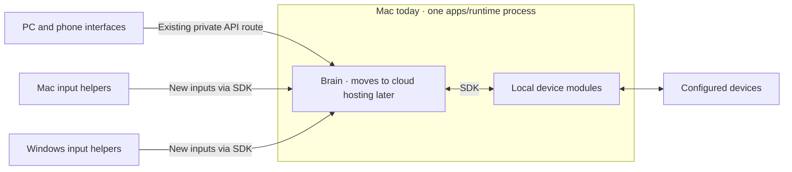

# ADR 0016: One brain and local edges

**Accepted direction.** This supersedes [ADR 0015](0015-two-machine-runtime.md).
[Owner decision](https://github.com/jimmie-potts/agent-device-hub/issues/1723#issuecomment-6869808383)

## Rules for new work

1. **Keep one authoritative brain.** The target is a cloud-hosted brain that
   owns state, history, inbox, automations, APIs and MCP. Device drivers and
   host input helpers are local edges. For now, the Mac keeps one authoritative
   copy of brain data and runs the brain and device modules in one
   `apps/runtime` process. Mac and Windows input helpers stay on the hosts
   where their inputs originate. PC and phone interfaces use the
   [existing private route](../../apps/runtime/PRIVATE-ACCESS.md) to the Mac's API.
   There is no brain data replication.
2. **Build interfaces on public APIs.** New module interfaces are pages that
   call the documented API under its access rules. Do not add server-built HTML
   pages or let interfaces read stores, files or module implementations directly.
3. **Keep device modules behind SDK calls.** Follow
   [ADR 0012](0012-bunny-event-platform.md#portability) for communication.
   Keep brain-owned data such as preferences and libraries separate from local
   device data, and keep one designated writer per physical device.
4. **Send new inputs as messages.** Use the existing SDK message contracts for
   new handoffs. Keep each input helper on the host that can read its source.
   Preserve existing supported file handoffs.

Preserve existing supported behavior until its own authorized change.

## First step toward separate hosting

Add separate sign-in for externally hosted interfaces so a second interface can
use the API. This stays in the backlog until the owner authorizes a start. Split
the device drivers into a separate local process only after a cloud host is
selected. This decision leaves the cloud provider, protocol, store, runtime and
migration open.

The [container standby profile](../bunny-container.md#settings-only-standby) and
[runtime settings reader and follower](../../apps/runtime/README.md#standby-peer-settings)
describe source that still exists. Their removal is separate work. The
[owner's follow-up decision](https://github.com/jimmie-potts/agent-device-hub/issues/1723#issuecomment-6869841142)
calls for preserving useful automation-edit history.
