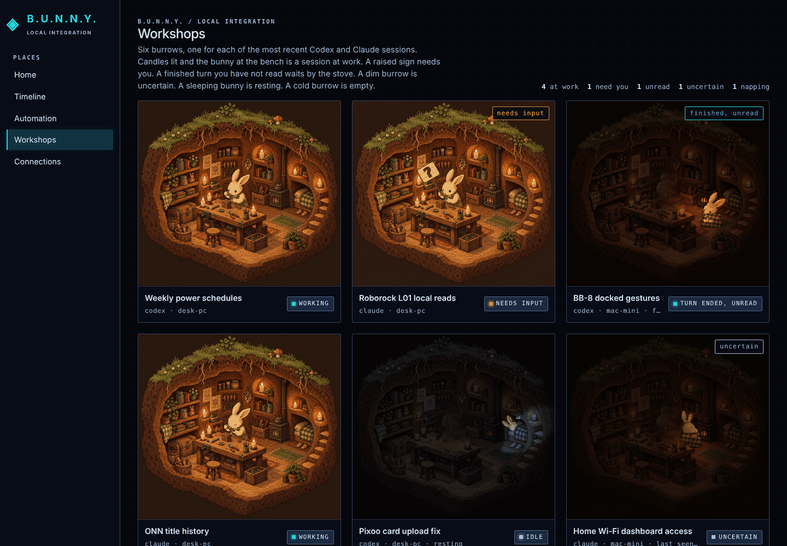
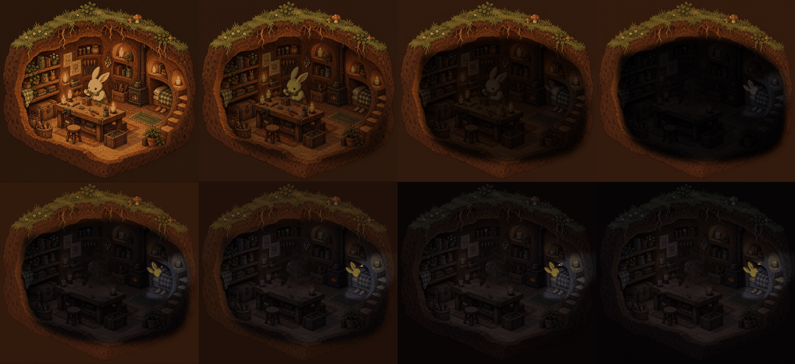

# Agent workshops: design reference

This is the art-direction preview the owner iterated on October 16 and 17,
2026, for [the workshops epic](https://github.com/jimmie-potts/agent-device-hub/issues/693).
It preserves the accepted look of the first slice: six candle-lit burrows in a
2-by-3 grid on the wide B.U.N.N.Y. dashboard, one scene and one bunny repeated,
each burrow showing the state of one of the six most recent Codex or Claude
sessions. The epic owns the delivery scope; the implementation story drafted
from this preview owns the behavior. This reference changes no release gate.

## Open the preview

Open [agent-workshops-preview.html](agent-workshops-preview.html) in a modern
browser from a local checkout or download. GitHub's file page displays source,
not a running page. The page loads only the files under `assets/` next to it;
there is no network request, model request, Hub connection or device operation.

The six burrows start in a mixed set of states. Use the controls under the grid
to change any slot's state, apply a day, evening, mixed or night scenario, start
all six loops in step, or simulate the reduced-motion preference. The clip table
at the end lists each clip's length and how much of the frame moves.

## What the preview demonstrates

- **One burrow, six states.** Working: the bunny hammers at the bench by
  candlelight. Needs input or approval: the bunny holds up a sign with a
  question mark. Turn ended and unread: evening, the bunny sits by the stove.
  Uncertain: the same evening room, dimmed, running at half speed. Idle: night,
  candles out, the bunny asleep in moonlight. Empty: the cold night burrow with
  nobody home.
- **Continuous motion.** Every occupied state is a full loop of the owner's
  generated animation at 10 frames per second: 60 seconds for the working loop,
  40 seconds for the others. The six slots start at different phases so
  identical burrows do not move in lockstep. Candle glow, flames, stove fire and
  the bunny keep moving for as long as the page is open.
- **Room-only state change.** When a slot changes state, the inside of the
  burrow dips toward dark over 1.6 seconds while the earth, grass and sky stay
  as they are, the new clip is swapped in under the dip, and the room comes back
  up. The dip is feathered inward from the burrow wall and never bleeds outside
  it, and it stops short of black.
- **Day and night.** When a change crosses from a lit state (working, needs
  input) to an evening or night state, or back, the whole scene also crossfades
  over 2.8 seconds with a brief warm wash on the exterior only, so the hillside
  passes through dusk or dawn.
- **Reduced motion.** With the preference set, every burrow shows the first
  frame of its clip, state changes cut instantly, and the caption chip and
  corner tag still name the state in text.
- **The dashboard shell.** The page sits inside the real shell proportions
  (sidebar, places navigation, grid-textured main area) with a Workshops entry,
  so the owner judged the grid at the width it will actually occupy.

## How the art is packaged

The owner generated the burrow scene, its five animations and a layer archive
outside this repository, from an image model and the archive's own Python
compositor. The sign animation was rendered from that archive with its bundled
script; the other four came from the owner's MP4 loops. The source videos, stills
and the archive stay with the owner and are not committed.

Each clip in `assets/` is one base still plus patch sheets. The extraction
decoded every video frame at the native 656 by 600, marked the pixels that move
anywhere in the loop (deviation from the median frame above a threshold, grown a
few pixels and cleaned), grouped them into connected regions, and packed each
region's frames into a lossless WebP sheet. `assets/manifest.json` records, for
every clip, the base image, frame count, rate and each sheet's position, size
and column count. The page composites base plus patches on a canvas at native
size, and the browser scales that one bitmap. This replaced scaling the videos,
which made the still wall shimmer behind the moving parts.

`assets/interior-mask.png` is the hand-traced interior of the burrow with an
inward feather. The dip, the content swap under it and the exterior-only dusk
wash all use this one mask. The thirty asset files total about 10 MB.

## Limits and provenance

Session titles, providers, hosts and states are synthetic fixtures chosen for
the preview, not a snapshot of any installation; the page reads no session
records. The timings, dip depth, dusk strength, clip lengths and the 2-by-3
arrangement are the design examples the owner reviewed, not a contract. Open
calls recorded on the page itself: the pace and depth of the dip and dusk, the
length of the sign loop, and 2-by-3 against 3-by-2.

The page runs continuous decorative motion with no pause control, which the
current motion rule in `docs/application-ui-style-guide.md` section 9 does not
allow. The owner decided on October 16, 2026, that the workshops page should
move continuously; the implementation story carries the style guide amendment.
The runtime dashboard's own reduced-motion rule and content security policy
apply to the implementation, not to this file.

Keep this directory as a frozen reference rather than editing it to track the
implementation. The HTML is the published preview with a standard document
wrapper and the assets moved under `assets/`; it is otherwise unchanged.
