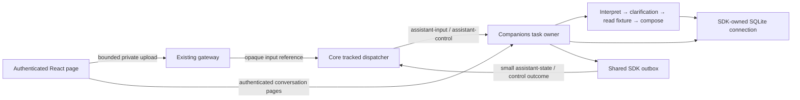

# Companions

One optional, statically shipped module owns fixed-text Reachy cards, synthetic
assistant tasks, explicit private preferences and companion knowledge. Reachy consumes
qualified first-live coding opportunities from the authoritative core and defaults
to disabled. Enable it on its Reachy page in the existing React dashboard; category mute and a one-hour
social snooze use the existing tracked command path. Settings completion means
the controls were saved; fixture completion means its synthetic input was
admitted. Card decision/publication and visibility are separate. Session attention remains
available independently of this module.

Reachy uses fixed phrases, with seeded variation and no model account, audio,
camera, sensors or device endpoint. Approval cards ask the human to review the
request; turn-ended cards have no response content or task-result evidence.
Cards identify their source/session, evidence, and decision reason. Publication
is not evidence that someone saw a card.

The module syncs sessions and Hub mode from `bunny/core`; it owns no second
lifecycle reducer or mode store. It keeps settings, at most 128 admission records and 4,096 consumed-origin receipts,
separate live/scenario social allowances, and the last presentation in its own
private SQLite file. Pending candidates are in memory only: one active and at
most one waiting in each category. Coding attention has priority and survives
Work/Quiet. Social scenarios require Free, known non-busy/non-media facts and
no active attention or snooze. Their shared allowance is three episodes per
local day, three hours apart across midnight. The local day uses the host's
IANA timezone, shown with the controls. Scenario records never consume a live
social slot or establish household perception.

Labelled arrival/visit and mixed question/arrival fixtures enter the same
rules/text/presentation path with identity and location unknown. Ordinary core
snapshots, duplicates, outbox recovery, reconnect, restart and return to Free
never create reaction opportunities. A saved card is restored as history.
Enablement, mute, mode, source freshness, attention/turn and expiry are checked
after asynchronous waits and immediately before new publication.

From the root with Node 24, run `npm run build`, `npm run typecheck`,
`npm run lint:js`, `npm run test:companions:built`, the affected runtime/event
checks, `reachy-text` catalog and the runtime dashboard browser/axe journey.
These checks use synthetic inputs and private disposable stores. Installed
client smoke and desk installation are separate evidence in the owning issues.

The assistant persistence qualification uses `node --test
modules/companions/dist/tests/checkpointer.test.js` after the root build. It
opens SQLite through the SDK, terminates a disposable process after a saved
interrupt and resumes in a fresh process. The existing companions CI test
discovery includes it; pending-write and namespace checks use the same saver.

## Synthetic assistant tasks

The **Synthetic tasks** page adds one default-off text workflow beside Reachy.
It uses a fake model and an immutable read fixture. No provider account, paid
call, worker dispatch, speech or physical device is involved. B.U.N.N.Y., Reachy
and MicroDuck keep separate conversation histories, with one unfinished task
across all three profiles and one graph invocation at a time.

`assistant-input/2.0` carries only a request ID and opaque input reference.
Private staging binds the text to that request, profile, expected state revision
and, for an answer, the task and question. Admission checks the binding again.
A five-second staging deadline and eight-input bound apply before admission;
admitted text and execution evidence are retained privately. Public state and
core operation records contain identifiers, status and counters, never text.
Existing read-scoped clients can read the private conversation route; it does
not grant control or add a conversation MCP tool.

A conversation ID is stable per profile; each task has its own ID. LangGraph's
`thread_id` is the task ID. The saved question ID survives restart, while each
explicit activation creates a new run ID. Call receipts use the task ID and
logical step ordinal, so a new run cannot repeat a saved effect. Future workspace
records can reference `{owner: "companions", conversationId, taskId, questionId?}`.
The model seam is one text function. Coding-worker dispatch has a separate owner
and is not a model adapter here.

The SDK owns the only SQLite connection. Domain records, private messages,
questions/answers, runs and call receipts are inspectable in `assistant_*`
tables beside the existing Reachy records. One revision sequence covers all companion
state families; one SDK sync owner serves their combined or separate snapshots.
Domain changes and their outcomes commit in the shared outbox transaction.
The module-local saver pins LangGraph 1.5.0 and checkpoint 1.2.0, serializes
checkpoints and pending writes, and uses synchronous graph durability. Checkpoint
and application projections are separate commits: startup reads the checkpoint
to repair that gap without invoking the graph.

A task runs `interpret → clarify → read → compose`. The clarification node does
no external work before interrupting. A saved answer can be explicitly resumed
after a crash between answer admission and continuation. Startup and outbox
republication never activate work. A running task is recovered as paused, waiting,
completed or uncertain from its durable evidence. A receipt without a result
keeps its reservation and cannot be retried automatically. Unsupported graph
versions retain readable history and refuse resume. There is no execution queue.

| Bound | Per task or request |
| --- | --- |
| Calls and questions | 4 model calls, 2 read calls, 2 questions |
| Active time | 120 seconds; human waits and downtime excluded |
| Deadlines | Model 30 seconds, read 5 seconds, control admission 5 seconds |
| Text and working state | Input 4 KiB, result 8 KiB, serialized graph/pending writes 32 KiB |
| Usage | 8,192 fake units reserved before dispatch; paid cost 0 |
| Private read | At most 16 messages and 64 KiB per page, advancing cursor |

Unknown usage stays unknown. A crash or timeout keeps the call's reserved time
and units; explicit continuation never resets them. Cancellation first saves a
generation fence, then requests abort. Late replies may add bounded receipt
evidence but cannot continue the graph or undo cancellation. If SQLite cannot
save the fence, cancellation is refused. A successful command receipt means
that local control was saved; task completion is reported separately.

The private content route is
`/modules/companions/content/conversation?profile=bunny&after=0`; profiles are
`bunny`, `reachy` and `microduck`. The first page includes `currentTask` with its
saved question and answer, subsequent pages use `currentTask: null`. Text is
retained through reload and private history remains visible during a dashboard
reconnect. Unsubmitted drafts remain in page memory only.

Diagnostics use the SDK's log, trace, clock, scheduler and abort signal and the
runtime's host adapter. Profile 1.6 registers assistant run/model/tool spans and
task/run/effect identifiers. Runs end at human waits or shutdown; a later run
links the previous run. No prompt, answer, tool body or raw exception is logged.
No LangSmith exporter is configured. Global LangChain/LangSmith tracing or
verbose flags make this synthetic executor unavailable, preventing implicit
content export. Reachy's fixed-text policy remains independent.

Run the root build and `npm run test:companions:built` for abrupt process exits,
pending-write fidelity, unknown-call recovery, cancellation, budgets, full disk,
outbox replay and private pagination. The `assistant-task` runtime catalog case
runs over both transports and in a disposable runtime. The existing companions
browser check exercises the real authenticated page with reload/restart,
keyboard, axe, disconnection and reader refusals while preserving Reachy.
These are synthetic source checks. They establish neither live-model usefulness
nor installed or physical acceptance.

## Explicit preferences

The **Preferences** page manages a small private library independently of the
Reachy and synthetic-task switches. Add a short title and text, inspect its
history, edit it, choose **Stop using**, or explicitly **Reactivate** it. New
owner-created entries are active; editing an inactive entry keeps it inactive.
IDs and full change snapshots survive restart in the same SDK-owned database.
No background learning, provider, transcript source or automatic context insertion
is added. Preference text is data and never grants permissions or device authority.

Select active entries and choose **Copy selected active preferences** for plain
text (`title`, newline, current text; blank lines between entries). The click
rereads current active values, excluding inactive and historical text even when
a selection was made earlier. Unsubmitted drafts stay only in page memory.
Stop using keeps private history and cannot retract earlier copies or exports.
Do not put passwords, tokens or other credentials in preferences. This is not an
arbitrary-prose secret detector.

### Private read and export contract

The authenticated route `/modules/companions/content/preferences` uses the
existing read grant; it grants no control. Its modes are:

| Query | Document | Contents |
| --- | --- | --- |
| omitted or `view=active` | `preferences/1.0` | `revision`, `entries`: current active records without history |
| `view=manage` | `preference-view/1.0` | `revision`, `entries`: every current record with history |
| `view=export` | `preference-library/1.0` | `entries`: every current record with history |

Each document has its version in `schema`. Records have `id`, `title`, `text`,
`active`, `createdAtMs` and `updatedAtMs`. Management/export records also have
`history`: ordered snapshots with `action`, `source`, `atMs`, `title`, `text`
and `active`. Actions are `created`, `edited`, `deactivated`, `reactivated` or
`imported`; source is `owner` or `import`. Imported files supply their earlier
history; that provenance is not independently verified evidence. The module's
package exports these TypeScript document types without exposing its store.

**Export library** downloads compact private JSON, including inactive entries
and history. Import validates the whole closed versioned document, including
unique IDs and consistent latest snapshots. It preserves every existing entry
exactly and inserts only missing IDs, always inactive. Each insertion retains
its original history and adds an inactive import snapshot. Repeated or older
exports cannot overwrite edits, replace history or reactivate an entry. A fresh
library also needs explicit activation after import. No snapshot replacement,
semantic deduplication or permanent erasure is provided.

### Controls, bounds and failures

Preference changes use the existing private upload at target `preferences`,
name `preferences.json`, with the `assistant-input/2.0` opaque envelope. The
private JSON input has `expectedRevision` and one action: `create` with title/text,
`edit` with ID/title/text, `set-active` with ID/active, or `import` with the export
in `library`. Existing `assistant` uploads keep their separate validation and
25,600-byte bound. Control authority, current revision, request binding and
five-second admission remain required. Eight private staged requests can wait;
restart discards them without applying them. Successful request receipts prevent
repeat effects. The core sees request IDs and opaque references only.

`preference-state/2.0` carries only `{id: "preferences", revision}` through the
existing owner and shared revision sequence. The dashboard refreshes its private
read after a state change or reconnect; it does not poll. Preference records,
revision, request receipt and outcome commit together through the SDK outbox.
A refused publication after commit stays committed and awaits publication.

Titles are limited to 200 UTF-8 bytes, text to 4096, and the serialized retained
library including history to 8 MiB. Uploads use the existing 10 MiB ceiling.
A full library or SQLite failure refuses the change without truncating history
or partially applying an import. Imported history plus the new import snapshot
and existing records must fit the retained limit. Existing records remain
readable/exportable. A revision conflict requires reviewing fresh state; an
uncertain result requires checking the tracked receipt, without automatic resend.

After the root build, `test:companions:built` covers the real SQLite lifecycle,
old/repeated import, rollback, full disk and staged-command boundaries. The
`preferences` scenario checks gateway grants, restart and content-free metadata
over both SDK transports and a disposable runtime. `test:companions:browser`
covers management, clipboard, private files, keyboard, narrow viewport and axe,
with existing assistant/Reachy journeys retained. Use a private temporary
directory outside every Git checkout for runtime checks. These are synthetic
source checks, not installed or physical acceptance.

## Companion knowledge and context

**Companion knowledge** manages explicit titled notes about people, relationships,
events or stated routines. It reuses the preference lifecycle: new owner entries
are active; Stop using keeps history; editing an inactive entry does not reactivate
it. Knowledge and preferences have separate records and document schemas. There
is no extraction from conversations or sensors, automatic learning, person graph
or recognition. Keep credentials out of notes and private files.

The page shows three curated profiles: B.U.N.N.Y. is a helpful generalist; Reachy
is articulate, expressive and diplomatic; MicroDuck is cheeky, expressive and
capable. Stable IDs are `bunny`, `reachy` and `microduck`. Optional explicit voice
references are stored independently of models; an absent selection stays absent.
A reference does not qualify an audio endpoint. This source adds no audio route.

Choose a persona, optionally choose a conversation and up to 16 messages, then
**Preview current context** or **Copy current context**. Each click reads current
active knowledge/preferences and the selected permitted messages. Other personas'
private conversations, inactive entries and historical knowledge snapshots are
excluded. Corrections and removals affect the next read. A large context is
refused rather than silently truncated. Nothing enters the synthetic assistant
graph automatically; copied data grants no permission or current location evidence.

### Conversation records

Authoritative conversation records extend `assistant_messages` on the existing
SDK SQLite connection. New `companion-message/1.0` records carry message and
conversation IDs, optional known turn/task identity, speaker, explicit or unknown
recipients, creation time, revision, creation ordering, meaning, provenance and
delivery references. Meaning is literal text/language, emotion with optional
intensity, or unknown. Legacy rows retain their IDs, sequence, time and text;
missing meaning, audience and delivery evidence remain unqualified. Operational
tool records, calls and checkpoints are not authoritative conversation/context.

**Create synthetic Reachy–Duck exchange** saves four labelled fictional messages
in one conversation shared by both personas. It generates no household facts,
audio or device commands. Duck English text is labelled intended meaning or
translation. Unknown meaning has no invented translation. Source portability
fixtures enforce quacks-only fake Duck audio; no live audio is qualified.

**Correct message** changes meaning and increments its revision without changing
creation order or original delivery references. **Remove message** removes its
authoritative text and retains ID/order/removal metadata. Latest Duck reads fall
back to the newest remaining Duck message, then empty. Correction/removal of an
unfinished task's message is refused until the task finishes or is cancelled.
This also applies to imported removals. Operational evidence and old files are
not securely erased; readers never fall back to those records for removed text.
Reads, import and startup never render messages or invoke the graph.

### Private contracts and recovery

All routes below use the existing authenticated read grant under
`/modules/companions/content/`. Read permission grants no control. Missing,
forbidden and unavailable reads use the shared error body; they are not empty
history. No new sharing destination is selected.

| Reference and query | Document |
| --- | --- |
| `knowledge?view=active` (default) | `knowledge/1.0`: current active entries and revision |
| `knowledge?view=manage` | `knowledge-view/1.0`: current entries and full history |
| `knowledge?view=export` | `knowledge-library/1.0`: entries and history |
| `companion-profiles` | `companion-profiles/1.0`: curated profiles and optional voice refs |
| `companion-history?profile=reachy` | `companion-history/1.0`: permitted conversations; `after` pages the list |
| `companion-history?profile=reachy&conversationId=<id>` | ordered messages; `after` advances creation sequence; optional `latest=microduck` returns latest or empty |
| `companion-context?profile=reachy` | `companion-context/1.0`: selected profile, current entries and explicit context; optional `conversationId` and comma-separated `messages`, `messages2` through `messages6` select records |
| `companion-archive` | `companion-archive/1.0`: knowledge, unchanged preference library, voices, conversations, messages and removals |

Context's optional `destination` accepts `local`, `claude` or `codex` under the
existing sharing choices; other values are refused. This is a read/copy boundary,
not a model sender or a new policy service. Context includes both assistant and
preference revisions and is assembled on demand without a persistent cache.
Split selections into groups of at most three IDs per query field, in the order
listed above. This supports all 16 selected IDs at their maximum 128-character
length without exceeding the gateway's 512-character value or 16-field limits.

Changes stage `knowledge.json` at target `knowledge` through the existing opaque
`assistant-input/2.0` command. Each private input has `expectedRevision`, from the
knowledge view. Actions are `create`, `edit`, `set-active` and standalone `import`
(as preferences, with the knowledge library schema), `fixture`, `correct-message`
(messageId/meaning), `delete-message` (messageId), `set-voice` (persona/voiceRef,
nullable), and `import-archive` (archive). The existing core owns authentication,
Origin, grants and tracked outcomes. Assistant-state metadata invalidates content
reads; preference changes also invalidate explicit context. No polling or prose
in shared state/commands/outcomes/diagnostics is added.

Archive import validates the whole document, then commits one outbox transaction.
Existing knowledge/preferences and their histories remain unchanged; missing
entries arrive inactive, including in an empty store. Existing explicit voice
selections win. Local message corrections win and imported messages stay
historical, with file provenance marked imported. Conflicting identity or
creation order refuses the file. Known removals defeat imported content.

Exported removal metadata contains no deleted text. Use a **current export** for
fresh recovery that must preserve removals: an old standalone file cannot know
about later deletions. Reimporting that old file into a store which already knows
the removals cannot resurrect them. Import does not replace a snapshot, replay
work, rewrite checkpoints or retract content from other clients.

Titles/text retain the preference limits (200/4096 UTF-8 bytes); each retained
entry library including history is at most 8 MiB. Meaning text is at most 8 KiB.
History pages contain at most 16 conversations or messages and 64 KiB; context is
at most 16 explicitly selected messages and 64 KiB. The combined archive is at
most 8 MiB and staging at most 10 MiB, eight requests and five seconds. Capacity
refusal preserves current records and history. If separately growing preferences
or existing assistant history exceed the archive/context bound, those reads
report capacity rather than claiming a complete export or truncating records.

The companions SQLite suite covers legacy migration, additive imports, removals,
source/revision/expiry checks, full disk and rollback. The `companion-knowledge`
catalog scenario exercises public reads through two fake model adapters and a
replacement test client over both transports and a disposable runtime. The
companions browser journey covers keyboard, clipboard, private files, profile
inspection, correction/removal, narrow layout, axe, reader access and disconnect.
All are synthetic source evidence; live providers, installed access paths and
physical acceptance remain separate.
