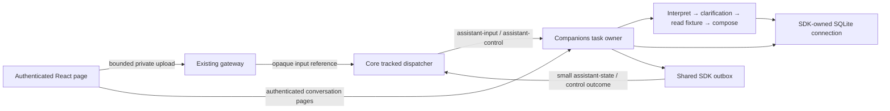

# Companions

One optional, statically shipped module consumes qualified first-live coding
opportunities from the authoritative core. It defaults to disabled. Enable it
on its Reachy page in the existing React dashboard; category mute and a one-hour
social snooze use the existing tracked command path. Settings completion means
the controls were saved; fixture completion means its synthetic input was
admitted. Card decision/publication and visibility are separate. Session attention remains
available independently of this module.

Reachy uses fixed phrases, with seeded variation and no model account, audio,
camera, sensors or device endpoint. Approval cards ask the human to review the
request; turn-ended cards have no response content or task-result evidence.
Cards identify their source/session, evidence, and decision reason. Publication
is not evidence that someone saw a card.

The module syncs sessions and Hub mode from `bunny/core`; it owns no second
lifecycle reducer or mode store. It keeps settings, at most 128 admission records and 4,096 consumed-origin receipts,
separate live/scenario social allowances, and the last presentation in its own
private SQLite file. Pending candidates are in memory only: one active and at
most one waiting in each category. Coding attention has priority and survives
Work/Quiet. Social scenarios require Free, known non-busy/non-media facts and
no active attention or snooze. Their shared allowance is three episodes per
local day, three hours apart across midnight. The local day uses the host's
IANA timezone, shown with the controls. Scenario records never consume a live
social slot or establish household perception.

Labelled arrival/visit and mixed question/arrival fixtures enter the same
rules/text/presentation path with identity and location unknown. Ordinary core
snapshots, duplicates, outbox recovery, reconnect, restart and return to Free
never create reaction opportunities. A saved card is restored as history.
Enablement, mute, mode, source freshness, attention/turn and expiry are checked
after asynchronous waits and immediately before new publication.

From the root with Node 24, run `npm run build`, `npm run typecheck`,
`npm run lint:js`, `npm run test:companions:built`, the affected runtime/event
checks, `reachy-text` catalog and the runtime dashboard browser/axe journey.
These checks use synthetic inputs and private disposable stores. Installed
client smoke and desk installation are separate evidence in the owning issues.

The assistant persistence qualification uses `node --test
modules/companions/dist/tests/checkpointer.test.js` after the root build. It
opens SQLite through the SDK, terminates a disposable process after a saved
interrupt and resumes in a fresh process. The existing companions CI test
discovery includes it; pending-write and namespace checks use the same saver.

## Synthetic assistant tasks

The **Synthetic tasks** page adds one default-off text workflow beside Reachy.
It uses a fake model and an immutable read fixture. No provider account, paid
call, worker dispatch, speech or physical device is involved. B.U.N.N.Y., Reachy
and MicroDuck keep separate conversation histories, with one unfinished task
across all three profiles and one graph invocation at a time.

`assistant-input/2.0` carries only a request ID and opaque input reference.
Private staging binds the text to that request, profile, expected state revision
and, for an answer, the task and question. Admission checks the binding again.
A five-second staging deadline and eight-input bound apply before admission;
admitted text and execution evidence are retained privately. Public state and
core operation records contain identifiers, status and counters, never text.
Existing read-scoped clients can read the private conversation route; it does
not grant control or add a conversation MCP tool.

A conversation ID is stable per profile; each task has its own ID. LangGraph's
`thread_id` is the task ID. The saved question ID survives restart, while each
explicit activation creates a new run ID. Call receipts use the task ID and
logical step ordinal, so a new run cannot repeat a saved effect. Future workspace
records can reference `{owner: "companions", conversationId, taskId, questionId?}`.
The model seam is one text function. Coding-worker dispatch has a separate owner
and is not a model adapter here.

The SDK owns the only SQLite connection. Domain records, private messages,
questions/answers, runs and call receipts are inspectable in `assistant_*`
tables beside the existing Reachy records. One revision sequence covers both
state families; one SDK sync owner serves their combined or separate snapshots.
Domain changes and their outcomes commit in the shared outbox transaction.
The module-local saver pins LangGraph 1.5.0 and checkpoint 1.2.0, serializes
checkpoints and pending writes, and uses synchronous graph durability. Checkpoint
and application projections are separate commits: startup reads the checkpoint
to repair that gap without invoking the graph.

A task runs `interpret → clarify → read → compose`. The clarification node does
no external work before interrupting. A saved answer can be explicitly resumed
after a crash between answer admission and continuation. Startup and outbox
republication never activate work. A running task is recovered as paused, waiting,
completed or uncertain from its durable evidence. A receipt without a result
keeps its reservation and cannot be retried automatically. Unsupported graph
versions retain readable history and refuse resume. There is no execution queue.

| Bound | Per task or request |
| --- | --- |
| Calls and questions | 4 model calls, 2 read calls, 2 questions |
| Active time | 120 seconds; human waits and downtime excluded |
| Deadlines | Model 30 seconds, read 5 seconds, control admission 5 seconds |
| Text and working state | Input 4 KiB, result 8 KiB, serialized graph/pending writes 32 KiB |
| Usage | 8,192 fake units reserved before dispatch; paid cost 0 |
| Private read | At most 16 messages and 64 KiB per page, advancing cursor |

Unknown usage stays unknown. A crash or timeout keeps the call's reserved time
and units; explicit continuation never resets them. Cancellation first saves a
generation fence, then requests abort. Late replies may add bounded receipt
evidence but cannot continue the graph or undo cancellation. If SQLite cannot
save the fence, cancellation is refused. A successful command receipt means
that local control was saved; task completion is reported separately.

The private content route is
`/modules/companions/content/conversation?profile=bunny&after=0`; profiles are
`bunny`, `reachy` and `microduck`. The first page includes `currentTask` with its
saved question and answer, subsequent pages use `currentTask: null`. Text is
retained through reload and private history remains visible during a dashboard
reconnect. Unsubmitted drafts remain in page memory only.

Diagnostics use the SDK's log, trace, clock, scheduler and abort signal and the
runtime's host adapter. Profile 1.6 registers assistant run/model/tool spans and
task/run/effect identifiers. Runs end at human waits or shutdown; a later run
links the previous run. No prompt, answer, tool body or raw exception is logged.
No LangSmith exporter is configured. Global LangChain/LangSmith tracing or
verbose flags make this synthetic executor unavailable, preventing implicit
content export. Reachy's fixed-text policy remains independent.

Run the root build and `npm run test:companions:built` for abrupt process exits,
pending-write fidelity, unknown-call recovery, cancellation, budgets, full disk,
outbox replay and private pagination. The `assistant-task` runtime catalog case
runs over both transports and in a disposable runtime. The existing companions
browser check exercises the real authenticated page with reload/restart,
keyboard, axe, disconnection and reader refusals while preserving Reachy.
These are synthetic source checks. They establish neither live-model usefulness
nor installed or physical acceptance.
